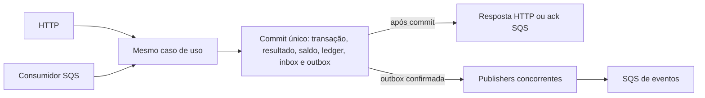

# Arquitetura inicial — Distributed Wagering Processor

**Estado: E1 implementada e validada.** A seção 1 descreve a base existente; os mecanismos financeiros das seções seguintes continuam desenho futuro, sem implementação. D01, A01 e A02 foram confirmadas pelo usuário. A especificação integral está em [CHALLENGE.md](CHALLENGE.md) e os critérios de entrega em [PLAN.md](PLAN.md).

## 1. Escopo e decisões já fixadas

Bun 1.x, TypeScript estrito, NestJS, MikroORM, PostgreSQL, AWS SQS via LocalStack e Docker Compose são escolhas do usuário. As versões exatas foram consultadas no registro oficial e nas documentações abaixo antes da instalação. package.json fixa as dependências diretas; bun.lock fixa a resolução transitiva; `.bun-version` e packageManager fixam Bun 1.4.4. Compose fixa tag e digest das duas imagens.

Autenticação está adiada conforme permitido na §2. `ProviderIdentityPort` existe em application/identity e é registrada em IdentityModule com um adaptador de desenvolvimento que retorna a identidade declarada e `authenticated: false`. Os únicos endpoints atuais são health, abertos. Quando existir adaptador HTTP financeiro, ele chamará essa porta antes do use case. Posteriormente um adaptador OIDC poderá validar token de IdP externo e vincular seu provedor ao `providerId` solicitado. Não há autenticação artesanal nem tabela de senhas. O futuro consumidor SQS manterá as validações de domínio, embora seu transporte seja interno confiável.

Inspeção inicial: apenas README.md, com 746 linhas; sem código ou instruções locais adicionais. O enunciado foi copiado integralmente para CHALLENGE.md, cujo conteúdo permanece intacto. README agora contém setup, comandos e limites da base E1.

### Base efetivamente entregue em E1

| Item | Implementação e verificação |
|---|---|
| Runtime e compilação | Bun 1.4.4; TypeScript 6.0.3 com strict, noUncheckedIndexedAccess, exactOptionalPropertyTypes e noEmitOnError; ESM/NodeNext; build com tsc e execução com Bun. NestJS 12.4.0, com injeção explícita por @Inject |
| Persistência | MikroORM 7.2.8 + integração NestJS 7.1.0; PostgreSQL 17.11-alpine por digest; conexão lazy do ORM 7 e SELECT 1 real em readiness; nenhuma entidade financeira |
| Isolamento | Middleware oficial cria RequestContext por HTTP; allowGlobalContext = false; readiness exige getContext(). Teste com duas execuções sobrepostas comprova EMs distintos e uso global proibido. Jobs futuros usarão RequestContext.create ou fork, sem wrapper antecipado |
| Migrations | Migrator e CLI 7.2.8 registrados; diretório versionável de fontes Migration*.ts e execução compilada Migration*.js; pending/up/down por scripts. Não há migration financeira; reversibilidade de schema ainda não foi testada |
| SQS local | AWS SDK 3.1164.0; LocalStack Community 4.14.0 por digest; hook idempotente cria comandos, DLQ e eventos; comandos com redrive maxReceiveCount = 5 e visibilidade 30s |
| Configuração | Zod 4.6.7 valida env antes de iniciar; .env.example só com valores locais fictícios, .env ignorado; erros mostram nomes de campos sem valores |
| Health | GET /health/live sem IO externo; GET /health/ready consulta DB e as três filas em paralelo, com HEALTH_TIMEOUT_MS, AbortSignal SQS, maxAttempts 1 e timeouts nativos pg |

O deadline da resposta PostgreSQL não é apresentado como cancelamento mágico da operação: query_timeout, connectionTimeoutMillis e statement_timeout também limitam o driver/servidor. Em E1 os limites usam HEALTH_TIMEOUT_MS, default 1000ms; terão de ser reavaliados para migrations/operações demoradas. No SQS, o mesmo AbortSignal limita todas as consultas de filas daquele probe. Cada dependência vira up/down, sem devolver detalhes internos da exceção.

O smoke inicia a API **compilada**, consulta os serviços reais e para/pausa cada container. Parada verifica falha e recuperação; pausa verifica deadline diante de conexão sem resposta. Em ambos, readiness retorna 503 e liveness continua 200; ao restaurar dependências, a mesma API volta a readiness 200.

### Compatibilidade consultada e escolhas de versões

- [Bun — TypeScript e tipos](https://bun.com/docs/runtime/typescript): runtime/package manager/test runner 1.4.4 e @types/bun da mesma versão, conferidos também no [registro oficial](https://registry.npmjs.org/bun/1.4.4).
- [NestJS 12 — ESM](https://docs.nestjs.com/migration-guide) e [pacote oficial 12.4.0](https://registry.npmjs.org/@nestjs/core/12.4.0): common/core/platform-express na mesma versão. Não dependemos do gerador CLI nem de seu runner padrão.
- [MikroORM 7 — ESM, TypeScript e driverOptions](https://mikro-orm.io/docs/upgrading-v6-to-v7): NodeNext, TypeScript >=5.8 e opções pg diretamente em driverOptions. TypeScript 6.0.3 atende esse contrato e foi usado no build; não foi necessário adotar TypeScript 7. As engines Node do pacote não provam compatibilidade de Bun; a suíte real verifica o conjunto usado aqui.
- [Integração NestJS](https://mikro-orm.io/docs/usage-with-nestjs) e [peers da integração 7.1.0](https://registry.npmjs.org/@mikro-orm/nestjs/7.1.0): compatível com Nest 12 e ORM 7; driver PostgreSqlDriver explícito em forRootAsync para registrar o token de EM correto. [Migrator](https://mikro-orm.io/docs/migrations) registrado sem schema sync.
- [PostgreSQL — versões mantidas](https://www.postgresql.org/support/versioning/): 17.11 escolhido e imagem confirmada por digest. [Driver pg — timeouts](https://node-postgres.com/apis/client) usados na probe.
- [Release oficial LocalStack 4.14.0](https://github.com/localstack/localstack/releases/tag/v4.14.0), [hooks de inicialização](https://docs.localstack.cloud/aws/customization/advanced/initialization-hooks/) e [mudança de distribuição/autenticação](https://blog.localstack.cloud/localstack-for-aws-release-2026-03-0/): edição comunitária anterior à exigência de token, suficiente para SQS local. É um pin antigo deliberado para este exercício, não uma recomendação de versão atual para produção.

Limites desta base: o volume PostgreSQL persiste, mas LocalStack é descartável e recria filas sem garantia de preservar mensagens. O usuário PostgreSQL inicial é administrativo local; separação de papéis fica em E4. Hooks e redrive configurados não comprovam retry/DLQ de consumidor, ainda inexistente. Não há Money, tabelas financeiras, operações, consumers/publisher, triggers, métricas financeiras ou unidade de trabalho financeira implementados.

## 2. Organização proporcional

Um serviço NestJS, um PostgreSQL e LocalStack. O mesmo executável pode habilitar HTTP, consumidor, reprocessador de referências e publisher por configuração, inclusive em três ou mais processos. Não precisamos de microserviços separados.

| Camada | Responsabilidade | Dependências permitidas |
|---|---|---|
| Domínio | Money, Wallet, WagerTransaction, Ledger, Inbox, Outbox, erros e eventos concretos; invariantes e transições explícitas | TypeScript e primitivas exatas; sem NestJS, ORM ou SDK AWS |
| Aplicação | Casos de uso de abertura, processamento, consulta e reconciliação; coordenação da unidade de trabalho; classificação dos resultados | Domínio e portas específicas de persistência/identidade |
| Infraestrutura e entradas | Controllers/DTOs NestJS, mapeamentos MikroORM, migrations SQL, SQS, agendamento, logs e métricas | Aplicação e bibliotecas externas |

Factories com construtores privados/protegidos; `rehydrate` reconstrói o estado salvo sem repetir regras de transição. Entidades de persistência ficam separadas das classes de domínio para não contaminá-las com decorators ou Unit of Work. Mapear explicitamente, sem framework de mapeamento.

Somente as portas necessárias: unidade de trabalho transacional com acesso às operações de wallet/transação/ledger/inbox/outbox, leitura para consultas e `ProviderIdentityPort`. Sem repositório genérico, command bus, event bus interno, camada de handlers por operação ou event sourcing. BET/WIN/LOSS/REFUND/ROLLBACK podem ser regras explícitas em um mesmo serviço de domínio enquanto isso continuar legível.

HTTP e SQS chamam o mesmo caso de uso financeiro com um comando normalizado. A origem SQS acrescenta os dados de inbox à unidade de trabalho; o controller não reimplementa regras financeiras. O reprocessador reutiliza a avaliação da operação persistida, sem criar nova identidade nem simular novo POST.

## 3. Money exato e limites

**Decisão D01 confirmada pelo usuário:** Money usará `bigint` em centavos e BIGINT no PostgreSQL, com código de moeda separado. A implementação começa em E2. O exemplo Decimal da §6.1 é adaptável; não há multiplicação, juros ou divisão no desafio. Inteiros tornam soma, subtração e igualdade exatas sem configurar precisão de uma biblioteca decimal.

- API recebe e devolve `{ amount: "25.00", currency: "BRL" }`. Valor nunca passa por `Number`, `parseFloat`, multiplicação de number por 100 ou parser monetário do driver configurado para number.
- Contrato externo exige string com **exatamente duas casas**, formato `^(0|[1-9][0-9]*)\.[0-9]{2}$`. Rejeitar sinal, espaços, vírgula, zeros à esquerda não canônicos, notação científica, NaN, Infinity, vazio e tipo JSON numérico. Essa gramática mais estrita é uma proposta de contrato, explicitada em A04.
- Separar parte inteira e centavos como texto; formar o inteiro por operações de string/BigInt. Serializar por divisão e resto inteiros, com duas casas. Não usar JSON.stringify diretamente em bigint: o DTO devolve strings.
- Operações internas podem produzir Money negativo, necessário para negate, subtração e diferença de reconciliação. A validação de entrada não proíbe resultados internos negativos. Wallet mantém sua própria regra de saldo não negativo.
- Todo cálculo retorna nova instância; moedas diferentes lançam erro, inclusive em comparações. Validar o código ISO-4217; a entrada da aplicação aceitará apenas BRL, como simplificação autorizada. O modelo e os testes continuam tratando outra moeda válida para comprovar conflitos. Não há conversão cambial.
- Banco usa **BIGINT em centavos** e moeda em TEXT. O conversor de infraestrutura lê string ou bigint do driver e reidrata Money sem conversão intermediária para number.
- Limite de valor persistível não negativo: `92233720368547758.07`, correspondente ao máximo de BIGINT em centavos. Validar capacidade antes da escrita; crédito que exceder o limite é rejeição explícita `BALANCE_LIMIT_EXCEEDED`. O cálculo em bigint permite detectar isso sem overflow. É limite técnico da representação, não limite de aposta inventado.
- Money interno pode calcular diferenças e somas maiores que o limite persistível; validar o limite no contrato/persistência de campos monetários. Assim, uma reconciliação de dados divergentes não perde precisão ao somar o ledger.
- Não arredondar entradas. O teste de arredondamento solicitado na §13 comprovará a rejeição de precisão excedente, como `"0.005"`, e ausência de arredondamento implícito.

BIGINT torna a escala uma convenção única de armazenamento: uma unidade é sempre um centavo. NUMERIC também seria exato, mas demandaria controlar coerção de escala no banco e configuração de decimal. Se surgir necessidade de moedas com outra escala ou cálculo fracionário, esta escolha deverá ser revista; isso não está no desafio. O [intervalo de BIGINT é definido pelo PostgreSQL](https://www.postgresql.org/docs/current/datatype-numeric.html).

## 4. Estados e regras financeiras

| Estado atual | Próximos estados permitidos |
|---|---|
| PENDING | PENDING_REFERENCE, PROCESSED, REJECTED, FAILED |
| PENDING_REFERENCE | PROCESSED, REJECTED, FAILED |
| PROCESSED / REJECTED / FAILED | Nenhum |

Reavaliar uma referência ainda ausente apenas atualiza metadados de retry; não chama novamente uma transição para o mesmo estado. `processedAt` identifica a aplicação bem-sucedida; rejeições/falhas terão instante terminal separado no resultado/metadados de persistência. Transicionar entidade terminal é erro de programação. Replay consulta o resultado, sem tentar transição.

- BET debita; WIN credita; LOSS registra PROCESSED sem ledger nem mudança de version.
- REFUND exige BET PROCESSED. ROLLBACK exige BET, WIN ou REFUND PROCESSED e inverte a direção da referência.
- Resolver por `(providerId, referenceExternalTransactionId)`; validar provider, player, wallet, moeda e rodada. Não acrescentar igualdade de gameId: o enunciado não a exige.
- REFUND/ROLLBACK são integrais: montante igual ao da referência. Um ROLLBACK que debite saldo insuficiente usa `REVERSAL_INSUFFICIENT_FUNDS`, diferente de `INSUFFICIENT_FUNDS` de BET.
- Checar reversão já processada **por tipo** sob o lock da wallet e com índice único no banco. Reversões rejeitadas não consomem o direito de uma reversão futura com outra identidade.
- OPENING é criado somente pelo caso de uso de abertura, quando initialBalance > 0. Abertura positiva produz CREDIT de zero até o saldo inicial; abertura zero não cria transação financeira. Ambas retornam version 1. OPENING nunca entra pelos DTOs HTTP/SQS.
- Version é contador de mudanças de saldo, não de comandos recebidos: criação = 1; depois +1 em cada mudança; LOSS, rejeição, replay e espera não incrementam. Não usar decorator de versão automática que incremente em qualquer UPDATE.

Não modelar estado da rodada, uma única WIN por BET, exclusão entre WIN e LOSS ou fechamento após settlement: não são requisitos. As propostas sobre zero, referências opcionais e combinação de reversões estão na seção 12.

## 5. Concorrência e unidade de trabalho

**Proposta D02:** isolamento READ COMMITTED e lock pessimista da **linha da wallet** com `SELECT ... FOR UPDATE`, mantido até commit/rollback. Isso serializa somente quem disputa a mesma wallet. Locks de linha e sua liberação são mecanismos do [PostgreSQL](https://www.postgresql.org/docs/current/explicit-locking.html); no [MikroORM](https://mikro-orm.io/docs/transactions), o lock será adquirido dentro de `EntityManager.transactional()`.

Cada requisição, mensagem ou execução de worker usa EntityManager/contexto isolado, sem compartilhar entidades gerenciadas entre operações simultâneas. Usar um fork limpo e o EM recebido na transação para todas as consultas, inclusive SQL específico. Não carregar wallet fora da transação e reutilizar um saldo antigo do Identity Map.

Ordem financeira comum:

1. Validar contrato, normalizar comando e calcular hashes; nenhuma chamada externa dentro da transação financeira.
2. Iniciar transação SQL. Quando SQS, inserir/verificar inbox por chave e hash. A identidade da mensagem é conferida antes de aceitar replay de inbox.
3. Adquirir a linha da wallet por FOR UPDATE. A criação de wallet usa a unique `(playerId, currency)`, pois ainda não existe linha para bloquear.
4. Localizar/reservar a identidade da WagerTransaction; se existente, comparar hash e devolver snapshot. No worker, bloquear a transação existente **depois** da wallet e revalidar status/vencimento.
5. Resolver referência e validar regra. Aplicar domínio; persistir status/resultado, eventual saldo/version/ledger e eventos da outbox. Se houver inbox, marcar o tratamento no mesmo commit.
6. Aguardar o COMMIT real, inclusive constraints diferidas. Só então responder sucesso HTTP ou executar DeleteMessage no SQS.

A consulta rápida de idempotência antes do lock pode ser uma otimização de replay, nunca a proteção contra corrida. Uniques continuam obrigatórias: duas entradas ainda podem disputar uma mesma key apontando para wallets distintas. Usar INSERT ON CONFLICT com releitura ou desfazer/reexecutar a unidade de trabalho em caso de unique violation. Não capturar erro SQL e continuar usando uma transação abortada. Conferir tanto a key quanto a identidade externa para não esconder colisões cruzadas.

Inbox precede wallet apenas no recebimento SQS; workers de referência não adquirem inbox antiga. Nenhum fluxo bloqueia transação de aposta antes de wallet, nem mantém duas wallets bloqueadas: referências de outra wallet são rejeitadas após consulta, sem bloquear essa segunda wallet. Isso reduz ciclos de deadlock. Timeouts/deadlocks ainda são possíveis; fazer no máximo três tentativas curtas da unidade inteira, com novo contexto e jitter. Ao esgotar, HTTP 503 ou retry SQS; não converter contenção em rejeição financeira.

No cenário obrigatório, o primeiro BET de 80 bloqueia wallet de 100, grava saldo 20 e confirma. O segundo só avalia saldo após obter o lock e lê 20, então persiste REJECTED. Um lock da aplicação, FIFO ou version isolada não é a garantia; o lock compartilhado entre instâncias é do PostgreSQL.

## 6. Schema, índices e proteções

Proposta de cinco tabelas centrais: `wallets`, `wager_transactions`, `wallet_ledger_entries`, `inbox_messages` e `outbox_messages`. Nenhuma tabela separada de saldo, idempotência ou round é necessária.

| Tabela | Constraints, índices e dados relevantes |
|---|---|
| wallets | PK id; UNIQUE(player_id, currency); balance_minor BIGINT NOT NULL CHECK >= 0; version inteiro positivo; moeda com formato de três letras; player/moeda imutáveis |
| wager_transactions | PK id; UNIQUE(idempotency_key) para entradas externas; UNIQUE(provider_id, external_transaction_id); FK wallet_id; FK opcional reference_transaction_id; checks de kind/status, quantia não negativa e referência externa obrigatória para REFUND/ROLLBACK; referência interna NOT NULL quando a reversão é PROCESSED; hash e campos originais imutáveis; snapshots JSONB descritos na seção 7 |
| wallet_ledger_entries | PK id; FKs wallet_id e transaction_id sem cascade delete; UNIQUE(transaction_id, wallet_id); UNIQUE(wallet_id, wallet_version); valores BIGINT NOT NULL; quantia > 0; before/after >= 0; CHECK da aritmética por direção; trigger de imutabilidade |
| inbox_messages | PK composta (consumer_name, message_id); payload_hash NOT NULL, received_at, processed_at e disposição/resultado de transporte quando necessário; identidade/hash imutáveis; conclusão gravada uma vez |
| outbox_messages | PK id = eventId; aggregate_id, tipo, envelope JSONB, occurred_at, attempts >= 0, next_attempt_at e published_at; envelope/identidade imutáveis; índice parcial por (next_attempt_at, occurred_at, id) WHERE published_at IS NULL |

OPENING não tem identidade externa: provider/key/externalId/round/game podem ser NULL exclusivamente nesse kind, com CHECK recíproco exigindo-os para comandos externos. Isso evita inventar um provedor que colida com entradas reais. O mapeamento adapta o esqueleto de referência. FKs e campos de contexto permitem auditar rejeições: player/moeda solicitados podem divergir da wallet em uma REJECTED; exigir igualdade quando PROCESSED, sem impedir o registro da rejeição.

Índices adicionais dirigidos aos acessos:

- Índice único parcial `(reference_transaction_id, kind)` WHERE status = 'PROCESSED' AND kind IN ('REFUND', 'ROLLBACK'). A corrida entre duas reversões do mesmo tipo não termina em dois créditos.
- `(next_reference_attempt_at, id)` WHERE status = 'PENDING_REFERENCE', e índice em `(provider_id, reference_external_transaction_id)` para localizar dependências; a unique de identidade externa resolve a referência.
- Paginação de ledger usa `(wallet_id, wallet_version)` já único; sem índice duplicado por timestamp. Índices de FKs usadas nas consultas/manutenção, especialmente ledger.transaction_id e referência interna, serão conferidos no desenho da migration.
- Resultados/snapshots não precisam de índice GIN; não haverá busca arbitrária no JSON.

NOT NULL acompanha os CHECKs: NULL não pode contornar validação. A aritmética do CHECK de ledger usa intermediários NUMERIC exatos se necessário para não estourar BIGINT durante a avaliação. A aplicação envia centavos inteiros ao driver após validar o contrato; não delegar a validação de casas decimais a coerções SQL. O schema armazena inteiros, mas não inspeciona o texto original de uma expressão SQL que já tenha sido convertida para BIGINT.

### Vínculo verificável entre wallet e ledger

Uma transação SQL de comando processa **uma operação financeira e no máximo uma mudança de saldo** da wallet; não implementar batch de várias operações da mesma wallet dentro de um commit. Acrescentar `wallet_version` ao ledger permite verificar a correspondência por índice, sem somar todo o histórico a cada escrita.

Propor triggers SQL com estas responsabilidades, implementadas e testadas em E4:

1. Guard de wallet: insert exige version 1; update exige version anterior + 1 somente se balance mudou, ou a mesma version se não mudou. IDs/player/moeda e histórico não podem ser reescritos.
2. Constraint trigger diferido da wallet: no COMMIT, cada mudança OLD.balance → NEW.balance exige uma entrada `(walletId, NEW.version)` cujo before/after sejam exatamente OLD/NEW. Para insert com saldo positivo exige OPENING/CREDIT, before zero e version 1; saldo zero não exige entrada.
3. Guard de inserção do ledger adquire a linha da wallet antes da validação. Constraint trigger diferido do ledger verifica, no estado final, wallet.version = entry.walletVersion e wallet.balance = entry.balanceAfter, além de mesma wallet/moeda/quantia da transação PROCESSED e direção coerente. Version 1 admite somente OPENING, before zero; versões posteriores não admitem OPENING.
4. Constraint trigger de WagerTransaction consulta o estado final da linha e confirma uma entrada para PROCESSED que mova saldo; LOSS, pendências, REJECTED e FAILED não podem possuir ledger. As regras de quantidade se somam à unique `(transactionId, walletId)`. Referências internas de reversões processadas devem resolver a identidade externa declarada; a nulidade não pode contornar o índice de reversão única.

A abertura estabelece o caso inicial. Cada mudança posterior só confirma com o lançamento da sua nova version; um lançamento isolado não pode ocupar uma version que já tem entrada nem criar uma version futura sem mudança de wallet. Os dois lados da verificação impedem omitir uma das escritas. A restrição de uma mudança por commit torna a comparação com o estado final inequívoca. Se surgir batch, revisar os triggers antes de permiti-lo.

Essas verificações são propostas a provar por SQL adversarial, inclusive alterações sem ORM e execuções simultâneas. Somente atomicidade SQL não detectaria um programador esquecendo de inserir ledger. Um CHECK também não faz validação segura entre tabelas: usar [constraint triggers diferíveis](https://www.postgresql.org/docs/current/sql-createtrigger.html) para esse vínculo, não uma função escondida em CHECK. [Constraints do PostgreSQL](https://www.postgresql.org/docs/current/ddl-constraints.html) fundamentam as proteções locais e de unicidade.

### Imutabilidade efetiva

- Ledger: triggers rejeitam UPDATE/DELETE e TRUNCATE; papel da aplicação só pode SELECT/INSERT, sem DDL, ownership, permissão de desabilitar triggers ou cascade destrutivo. Proibir também deletes de wallets/transações que invalidem histórico.
- WagerTransaction: payload, identidades e hash imutáveis desde criação; guard de transições válidas e proibição de alteração/exclusão de estados terminais. Campos de retry só mudam enquanto pendente.
- Snapshots de resultado escritos uma vez; envelope da outbox e identidade/hash da inbox não são alterados pelos respectivos workers. Metadados de publicação são mutáveis.
- Usar papel de migration separado do papel da aplicação. Um superusuário pode alterar o schema; não alegar proteção contra o administrador do banco. Down migrations são destrutivas apenas em bases descartáveis e devem remover triggers/FKs na ordem correta.

## 7. Idempotência durável e resultado histórico

**Proposta D03:** armazenar idempotência na própria WagerTransaction; nenhuma tabela ou cache adicional é necessário para operações aceitas. Unicidade global da key é proposta em A05. Também proteger `(providerId, externalTransactionId)` contra uma nova key criando o mesmo efeito.

Hash de negócio: SHA-256 sobre bytes UTF-8 de JSON canônico de um objeto construído com a lista explícita `providerId`, `externalTransactionId`, `playerId`, `walletId`, `roundId`, `gameId`, `kind`, `money.amount`, `money.currency`, `referenceExternalTransactionId` quando presente. Ordenar recursivamente chaves; preservar strings; não usar números monetários; ausência de referência é sempre omissão, nunca null. DTO rejeita campos desconhecidos e null onde o campo é opcional. Registrar versão 1 da canonicalização para futuras mudanças de contrato.

Não entram no hash: Idempotency-Key, messageId, occurredAt de transporte, correlationId, receipt handle e contador de entrega. Chave é identidade, não parte do payload que ela identifica. HTTP e SQS usam exatamente a mesma canonicalização. Ordenação das chaves do JSON de entrada não muda a operação.

Persistir junto ao commit:

- `acceptance_result` e respectivo status HTTP, escritos uma vez no primeiro aceite, inclusive PENDING_REFERENCE;
- `terminal_result` e respectivo status HTTP, escritos uma vez quando a operação termina;
- saldo observado ao decidir aquele resultado, transactionId, status, failureCode quando aplicável e versão de contrato. Valores monetários já em MoneyProps.

**Decisão A01 confirmada pelo usuário:** replay sempre retorna a **primeira resposta persistida e seu status HTTP**, alterando somente `idempotentReplay` para true. A primeira resposta usa false. Mesmo que um primeiro 202/PENDING_REFERENCE evolua para PROCESSED, o POST repetido continua retornando aquele 202 e seu saldo histórico. GET retorna a evolução atual da transação e seu resultado terminal histórico, quando disponível. Para uma operação síncrona terminal, os dois snapshots podem representar o mesmo resultado. Nenhuma dessas leituras substitui saldo histórico pelo saldo atual da wallet.

Mesma key/hash retorna resultado existente; mesma key/hash diferente gera 409 `IDEMPOTENCY_CONFLICT` sem alterar a operação original. Outra key com mesma identidade externa gera 409 `EXTERNAL_TRANSACTION_ID_CONFLICT`, mesmo com payload igual; não criar aliases de key silenciosamente. Unique violation exige releitura e comparação, não replay automático de qualquer colisão.

Falha de infraestrutura antes do commit não produz resultado confirmado. Se o cliente perder a resposta após o commit, reenviar a mesma key recupera o resultado. Sem expiração/limpeza de idempotência no escopo do desafio: apagar resultados permitiria reaplicar efeitos antigos.

Inbox tem outra identidade: hash do **envelope lógico canônico completo**, incluindo type, messageId, occurredAt e data/idempotencyKey, excluindo atributos de entrega do SQS. Usar messageId do envelope, não o ID atribuído pelo broker. Mesmo `(consumerName, messageId)` com hash diferente é colisão permanente de transporte, nunca replay aceito. Mesma operação em outra mensagem passa pela idempotência de negócio; uma nova inbox pode confirmar sem novo ledger/outbox.

## 8. Atomicidade e janelas de falha

WagerTransaction, snapshots, wallet/version, ledger, inbox quando houver e outbox usam **a mesma conexão e transação SQL**. Não executar publicação SQS, outra transação independente ou callback financeiro posterior ao commit. Eventos são instâncias de subclasses concretas de IntegrationEvent; data contém strings MoneyProps, e o envelope serializado é salvo na outbox.

A inbox participa quando a entrada vem do SQS; saldo e ledger só mudam quando a operação efetivamente movimenta dinheiro. O publisher usa outra transação, sem reabrir a operação financeira.

Eventos mínimos: Processed inclusive LOSS e OPENING; Rejected para rejeições de domínio; PendingReference uma vez ao entrar na espera; BalanceChanged somente quando houver mudança efetiva de saldo. Pending pode posteriormente gerar Processed/Rejected, mas não um novo evento de pending a cada retry. Replays não geram novos eventos financeiros.

| Falha | Mecanismo e resultado pretendido |
|---|---|
| Antes do commit financeiro, mesmo após INSERT de outbox/inbox | Rollback de todas as escritas; nenhum publisher vê a outbox não confirmada; SQS não recebe ack |
| Durante COMMIT, resposta do banco incerta | Não afirmar falha financeira definitiva; HTTP transitório/retry SQS com a mesma identidade consulta o estado persistido |
| Após commit, antes da resposta HTTP ou ack SQS | Snapshot/inbox recuperados no retry; sem segundo efeito |
| Após commit, antes de publicar eventos | Outbox pendente durável; outra instância publica |
| Após SendMessage, antes de confirmar publishedAt | Evento pode ser republicado com mesmo eventId; consumidor precisa dedup persistente |
| SQS indisponível | Operação pode confirmar com outbox acumulada; publisher faz backoff; readiness sinaliza indisponibilidade |

Entrada SQS que confirma PENDING_REFERENCE marca inbox como tratada e recebe ack: a responsabilidade futura já está no registro persistente e no worker. Não manter a mensagem bloqueando a fila por horas esperando a referência. Rejeição de domínio é terminal, confirma transação/resultado/evento/inbox e recebe ack.

Erros estruturais antes da criação de uma transação não precisam fabricar uma WagerTransaction nem um OPENING externo: retornar erro de contrato ou encaminhar a mensagem à DLQ. Quando houver envelope válido, a inbox pode registrar a disposição de transporte para auditoria.

## 9. Recuperação de referências

**Proposta D04:** persistir `referenceAttempts`, `nextReferenceAttemptAt` e `referenceExpiresAt` na transação. Defaults configuráveis: espera máxima de 24 horas desde o primeiro aceite; backoff de 5 segundos, exponencial e limitado a 5 minutos, com jitter. O tempo permite indisponibilidade/atraso prolongado no exercício, sem espera infinita. Não é um SLA pedido pelo enunciado.

O worker consulta candidatos vencidos sem reservar locks de transação; para cada candidato abre unidade de trabalho, bloqueia primeiro wallet e depois WagerTransaction, e revalida status e agendamento. Se outro worker já trabalhou, não faz nada. Seleção inicial pode se repetir entre workers; a revalidação impede aplicação duplicada. Não usar SKIP LOCKED sobre transações antes do lock da wallet, pois inverteria a ordem do caso de uso HTTP.

- Referência ausente ou ainda pendente: manter espera e gravar novo agendamento, sem ledger/alteração de saldo e sem repetir PendingReference.
- Referência PROCESSED válida: aplicar uma vez na mesma unidade de trabalho, gravando snapshot terminal e eventos. Não depender de uma notificação em memória quando a referência chega.
- Referência de tipo/contexto inválido, auto-referência ou terminal REJECTED/FAILED: rejeitar com código específico; não aguardar uma transição impossível.
- Avaliar primeiro o estado real da referência ao retomar. Se ainda ausente após TTL, REJECTED `REFERENCE_NOT_FOUND`, com evento. Se existe mas continua pendente após TTL, usar `REFERENCE_NOT_READY`. Se ficou válida durante uma queda e só foi encontrada ao retomar, processá-la; esse detalhe do TTL está proposto em A08.

Contar tentativas somente quando a verificação/agendamento confirma no banco. Uma falha de infraestrutura faz rollback e usa retry operacional, sem consumir silenciosamente tentativas de negócio. TTL é verificado quando o banco volta; não há cronômetro confiável enquanto o banco está inacessível. Persistência, índices e lock/rechecagem permitem retomada em outra instância.

## 10. SQS, DLQ e encerramento

Filas obrigatórias: `wager-transactions.fifo` e `wager-transactions-dlq.fifo`. MessageGroupId = walletId é otimização de ordenação; dedup ID de transporte = messageId. Redelivery, ingresso HTTP e expiração da dedup do broker continuam protegidos por inbox/uniques/lock no banco.

Proposta de configuração inicial: visibility timeout 30s, chamadas externas com timeout limitado e renovação de visibilidade durante trabalho prolongado; backoff de redelivery exponencial limitado a 5 minutos; `maxReceiveCount = 5` na redrive policy. Validar os tempos sob os containers e permitir configuração. O [visibility timeout](https://docs.aws.amazon.com/AWSSimpleQueueService/latest/SQSDeveloperGuide/sqs-visibility-timeout.html) não é exclusão financeira e a [redrive policy](https://docs.aws.amazon.com/AWSSimpleQueueService/latest/SQSDeveloperGuide/sqs-dead-letter-queues.html) conduz falhas repetidas à DLQ.

| Classificação | Persistência e ação de transporte |
|---|---|
| Negócio, inclusive rejeição de reversão e operação já terminal | Confirmar resultado/inbox/evento quando aplicável; DeleteMessage depois do commit |
| Referência pendente | Confirmar PENDING_REFERENCE/inbox/evento; ack; retry fica com worker agendado |
| Transitório: timeout, deadlock, DB/SQS indisponível | Rollback do trabalho não confirmado; backoff/visibilidade; sem ack; redrive após limite de recebimentos |
| Permanente: envelope inválido, versão não suportada, colisão de messageId | Sem novo efeito financeiro; não fazer ack como sucesso; deixar redrive levar à DLQ com tentativas limitadas; registrar código/IDs seguros |

Não assumir que todo envio à DLQ corresponde a uma WagerTransaction FAILED: uma mensagem inválida pode nem ter entidade válida. FAILED fica reservado a erro de infraestrutura classificado como permanente em operação aceita e ainda não terminal, com resultado auditável e sem ledger. Se esse resultado for confirmado, a inbox deve registrar disposição permanente/DLQ; redelivery não reaplica trabalho nem dá ack que impediria o redrive. Extensão de metadados da inbox é permitida pelo esqueleto. Uma operação já PROCESSED nunca vira FAILED por falha de ack.

Com redrive automático, mesmo um erro permanente pode ser recebido até o limite antes da DLQ. Isso evita um segundo protocolo de envio à DLQ mais DeleteMessage, que teria sua própria janela de duplicação. Uma falha transitória também pode chegar à DLQ após o limite; recuperá-la exige redrive operacional com a mesma identidade. Não criar retry infinito no consumidor.

SIGTERM: parar polling e novas reservas; aguardar trabalhos em andamento com prazo de 20s; fazer ack só dos commits concluídos. Se não puder concluir, rollback quando possível e reduzir visibilidade para permitir retomada. Se morrer abruptamente ou não conseguir devolver visibilidade, a expiração entrega de novo. Nunca desfazer commit financeiro para compensar falha de ack.

## 11. Publicação da outbox com múltiplos workers

**Proposta D05:** começar com reserva transacional curta, **sem leases**, uma mensagem por transação do publisher:

1. Selecionar evento vencido, com published_at NULL, em ordem estável, por `FOR UPDATE SKIP LOCKED`.
2. Manter somente o lock dessa linha de outbox, enviar seu envelope ao destino SQS com timeout limitado.
3. Em sucesso, marcar publishedAt e confirmar. Em erro conhecido, incrementar attempts, calcular próximo vencimento e confirmar o agendamento.
4. Crash/rollback libera o lock; outra instância volta a selecionar a linha. Enquanto bloqueada, os outros publishers pulam essa linha e trabalham nas demais.

[SKIP LOCKED é adequado a consumidores concorrentes de tabelas usadas como fila](https://www.postgresql.org/docs/current/sql-select.html). Aqui a chamada de rede ocorre numa transação **separada**, depois do commit financeiro; nenhum lock de wallet fica preso ao envio. O custo é ocupar uma conexão SQL durante a chamada SQS, limitada por timeout e concorrência configurada. Leases com token/fencing só serão necessários se esse custo se mostrar impeditivo; não incluí-los agora.

Backoff de publicação proposto: 1s exponencial com jitter, teto de 60s. Não apagar nem desistir automaticamente de evento confirmado: manter retry com alerta e métrica de lag. Configuração inválida/permanente requer correção operacional; não marcar publicado para esvaziar fila. Attempts conta falhas cujo agendamento confirmou; crash pode não incrementar o contador, sem perder o evento.

eventId é criado na transação financeira e preservado em todo envio; MessageDeduplicationId pode ser esse eventId, mas consumidor precisa de inbox/dedup persistente para além da janela FIFO. No teste, um consumidor real deduplica o eventId para comprovar segurança da republicação.

Não existe confirmação atômica conjunta entre PostgreSQL e SQS: se o envio chegou e a resposta se perdeu, haverá repetição. O mecanismo entrega **ao menos uma vez**, condicionado à recuperação dos serviços e dos workers. Quando uma tentativa consegue enviar e confirmar publishedAt, os publishers deixam de selecionar o evento. Não prometer número finito de duplicatas sob falhas infinitas, nem exactly-once no transporte.

O enunciado não especifica o destino; para E1 o usuário solicitou e foi criada `wager-events.fifo`, separada da fila de comandos. Publisher e consumidor de negócio de saída continuam futuros. MessageGroupId pode ser walletId; aggregateId = transactionId nos eventos de transação e walletId no evento de saldo. Não prometer ordem global nem ordem de versões por wallet com vários publishers: dois eventos podem ser enviados fora da ordem original. Consumidores usam identidade/versão e os dados necessários no envelope. Se ordenação estrita de saída for requerida, será outra decisão, ausente no desafio.

## 12. Ambiguidades e interpretações propostas

Os itens a seguir distinguem decisões confirmadas de propostas. A01 e A02 foram confirmadas pelo usuário; as demais continuam propostas até a etapa afetada e não bloqueiam E1.

| ID | Ambiguidade | Interpretação proposta e consequência |
|---|---|---|
| A01 — confirmada | §9 exige mesma resposta; uma pendência muda depois do primeiro 202 | Replay mantém a primeira resposta persistida e seu status HTTP, alterando só idempotentReplay. GET expõe evolução atual e resultado terminal histórico. Um POST inicialmente 202 continua 202 no replay, mesmo após processamento |
| A02 — confirmada | §7, regra 4, impede segunda reversão pelo mesmo tipo, sem excluir REFUND + ROLLBACK sobre a mesma BET | Aplicar literalmente a unique por referência + tipo: permitir um REFUND e um ROLLBACK sobre a mesma BET. Isso pode produzir dois créditos relativos à BET; manter esse efeito explícito. Não impor exclusão entre os tipos |
| A03 | Valores zero são proibidos apenas implicitamente pela tabela de operações com movimento | Propor BET/WIN/REFUND/ROLLBACK > 0, LOSS >= 0 e initialBalance >= 0. Zero em operação financeira vira rejeição auditável AMOUNT_MUST_BE_POSITIVE; LOSS pode carregar valor não negativo sem movimentá-lo. Evita ledger zero/version ambígua, mas precisa de decisão explícita |
| A04 | Amount tem escala fixa, mas não define zeros à esquerda ou aceitação de 25/25.0 | Exigir formato externo canônico com duas casas e sem zeros à esquerda, sem normalizar/arredondar formatos alternativos. Money interno aceita sinal apenas por operação/reidratação controlada, não pelo contrato externo |
| A05 | Escopo de Idempotency-Key não diz se é global ou por provedor | Propor global, como identidade literal do header. Providers devem usar prefixo sugerido, mas não será imposto o formato provider:externalId. Header é obrigatório; não gerar default silencioso. Mesma key usada por outro provider conflita |
| A06 | Mesmo externalTransactionId com nova key e referências em WIN/LOSS/BET | Propor conflito de identidade externa com key nova. WIN pode omitir referência; se informar, deve apontar BET da mesma rodada/contexto e pode aguardar quando ausente. BET/LOSS não aceitam referência. Não tornar referência obrigatória em WIN |
| A07 | Referência existe mas está pendente, rejeitada, em outro contexto ou é a própria operação | Esperar quando não terminal; rejeitar quando terminal sem processamento, inválida ou auto-referência. Sem impor igualdade adicional de gameId. Ausência de referência não significa wallet inexistente: não há requisito de esperar criação de wallet |
| A08 | TTL/tentativas de referência e semântica durante outage | TTL de 24h com backoff persistente; referência válida encontrada na retomada prevalece sobre expiração; inexistente ou ainda pendente expira com códigos distintos. Valores são defaults justificáveis e ajustáveis |
| A09 | Destino dos eventos e ordenação da saída não são definidos no enunciado | Fila local wager-events.fifo solicitada pelo usuário e criada em E1, distinta de comandos. Outbox ao menos uma vez com eventId estável e sem garantia extra de ordenação continua proposta para E11 |
| A10 | Limite monetário, status HTTP e momento do saldo de rejeições não definidos | Limite técnico BIGINT; mapeamento da seção 13; rejeição aceita guarda saldo observado sob o lock na decisão, sem movimento. Não consultar saldo vivo em replay |
| A11 | Identidade de provedor sem cadastro e campos internos de OPENING | providerId externo não vazio, opaco e validado no contexto; não inventar whitelist/cadastro de provedores. OPENING não tem identidade externa e não concorre com keys externas |
| A12 | FAILED, falhas de transporte e requisitos de retenção não detalhados | FAILED só para operação aceita com falha permanente classificável; payload impossível de modelar fica em DLQ sem entidade artificial. Retenção sem limpeza automática de ledger, idempotência/inbox/outbox no escopo; não é política de retenção ilimitada para produção |

## 13. API, reconciliação e observabilidade

Proposta de mapeamento consistente:

| Situação | HTTP / código estável |
|---|---|
| Wallet criada | 201 |
| Consultas e reconciliação executadas | 200, inclusive reconciliação divergente com consistent = false |
| Primeiro POST de transação PROCESSED | 200 / PROCESSED |
| Replay de POST | Status HTTP e corpo da primeira resposta persistida, alterando apenas idempotentReplay |
| Aceita pendente | 202 / PENDING_REFERENCE ou PENDING |
| JSON/DTO, dinheiro malformado, campo desconhecido, header ou referência obrigatória ausente | 400 / INVALID_PAYLOAD, IDEMPOTENCY_KEY_REQUIRED ou REFERENCE_REQUIRED |
| Recurso de consulta ou wallet solicitada inexistente, antes de aceitar operação | 404 / WALLET_NOT_FOUND ou TRANSACTION_NOT_FOUND |
| Key divergente, identidade externa com outra key, wallet duplicada | 409 / IDEMPOTENCY_CONFLICT, EXTERNAL_TRANSACTION_ID_CONFLICT, WALLET_ALREADY_EXISTS |
| Regra de negócio rejeitada após aceite | 422 / failureCode específico, snapshot persistido |
| Indisponibilidade/timeout transitório, commit incerto | 503 / INFRASTRUCTURE_UNAVAILABLE, com orientação de retry da mesma identidade |
| Falha permanente inesperada em operação aceita | 500 / PERMANENT_PROCESSING_FAILURE, estado FAILED quando persistível; reenviar não reaplica |

GET de uma transação REJECTED/FAILED retorna 200 com seu estado e failureCode: consultar o recurso teve sucesso. GET deve expor estado atual e o resultado financeiro histórico salvo; não trocar balance desse resultado pelo saldo atual da wallet. Validações rejeitadas antes de haver comando válido/wallet existente não reservam idempotency key; inbox pode auditar o resultado de transporte. Uma colisão de idempotência não converte a transação original em REJECTED.

Taxonomia inicial de **rejeições persistidas**, a estabilizar antes dos testes de contrato:

- `INSUFFICIENT_FUNDS`, `REVERSAL_INSUFFICIENT_FUNDS`, `AMOUNT_MUST_BE_POSITIVE`, `BALANCE_LIMIT_EXCEEDED`;
- `WALLET_PLAYER_MISMATCH`, `CURRENCY_MISMATCH`;
- `SELF_REFERENCE`, `REFERENCE_KIND_INVALID`, `REFERENCE_CONTEXT_MISMATCH`, `REFERENCE_AMOUNT_MISMATCH`;
- `REFERENCE_NOT_PROCESSED` para referência terminal rejeitada/falha; `REFERENCE_NOT_FOUND` e `REFERENCE_NOT_READY` na expiração;
- `ALREADY_REVERSED_BY_KIND` para tentativa adicional após reversão do mesmo tipo processada.

Ausência de referência obrigatória será erro de contrato 400 com REFERENCE_REQUIRED, sem criar transação: a factory não admite REFUND/ROLLBACK sem referência. Uma vez aceito um comando de domínio, toda rejeição persistida leva failureCode, resultado e evento. Códigos de erro de entrada/transporte ficam separados dos estados de transação; logs de exceção não substituem esses contratos.

Ledger paginado por walletVersion, em ordem definida, com cursor opaco contendo versão do formato, walletId, última version e um limite superior capturado na primeira página. Validar pertencimento do cursor à wallet e limit (default 50, máximo proposto 100). Inserções posteriores ficam acima desse limite e não deslocam a navegação; não usar offset nem timestamp isolado como ordenação.

Reconciliação usa transação read-only REPEATABLE READ com snapshot único para ler saldo e somar créditos menos débitos, incluindo OPENING. Calcular `difference = stored - calculated` com precisão exata; contar entradas. Snapshot evita divergência falsa entre duas consultas feitas antes/depois de uma escrita concorrente. Não reparar automaticamente: retornar consistent = false, emitir log seguro e incrementar métrica. Para wallet aberta com zero, soma vazia = zero.

Logs JSON incluem correlationId, messageId, transactionId, walletId e providerId quando disponíveis; campos indisponíveis ficam explicitamente ausentes/null. Não registrar payload financeiro, tokens ou valores de saldo completos. correlationId é propagado; eventos guardam causationId da mensagem/comando. Métricas de contagens por status, duplicatas, retries, DLQ, contenção/timeouts de lock, outbox lag e latência; IDs individuais vão nos logs, não como labels de cardinalidade alta.

`/health/live` verifica processo, sem consultar dependências. `/health/ready` consulta PostgreSQL e disponibilidade das filas SQS com timeout e retorna 503 em falha. A necessidade de SQS para readiness não impede que o mecanismo financeiro possa confirmar dados e deixar outbox pendente. Nenhum dos dois exige autenticação.

## 14. Riscos, evidências e próximo passo

- Hot wallet é serializada por escolha; throughput dessa wallet fica limitado pela duração do commit. Encurtar a transação e medir antes de trocar a estratégia. Wallets distintas continuam concorrentes.
- Triggers e mapeamento monetário exato serão o ponto de maior cuidado do schema futuro. Validar comportamento no COMMIT, abertura zero/positiva, bypass do ORM, papel restrito e concorrência; não considerar o desenho prova suficiente.
- Publisher mantém conexão enquanto chama SQS; limitar concorrência/timeout e observar pool/lag. Se necessário, evoluir para leases sem mudar o contrato financeiro.
- Replay da primeira resposta e combinação de reversões estão confirmados; conservar os impactos documentados, incluindo o primeiro 202 no replay e possível crédito de REFUND + ROLLBACK.
- Dependências reais, crashes e ≥3 processos serão indispensáveis para comprovar o sistema financeiro. E1 verificou somente configuração, integração da base e falhas de dependências; ainda não demonstra correção financeira distribuída.

Validação E1 em 08/11/2026: instalação com bun.lock congelado sem mudanças, typecheck e build concluídos; 13 testes de configuração e 9 smoke tests passaram. CLI retornou No pending migrations. Smoke comprovou filas/redrive, reexecução do hook, EMs isolados, ausência de tabelas financeiras, indisponibilidade e timeout de ambas as dependências com liveness preservada. Docker Engine 29.6.1 rootless e Compose 5.2.0; nenhuma verificação E1 ficou bloqueada.

Trabalho encerrado em E1. E2 implementará Money conforme D01 quando o usuário solicitar. As propostas restantes serão revistas nas etapas correspondentes, sem reabrir as decisões já confirmadas.
