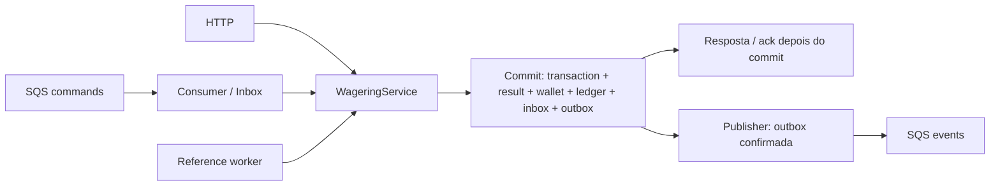

# Arquitetura — Distributed Wagering Processor

Implementação obrigatória E0–E13 entregue e verificada: 241 testes unitários, 109 integrações e nove smoke, zero falhas. Evidências executadas: [VALIDATION.md](VALIDATION.md). Etapas e rastreabilidade: [PLAN.md](PLAN.md). Especificação preservada: [CHALLENGE.md](CHALLENGE.md).

## Decisões confirmadas e interpretações adotadas

| Decisão | Implementação/consequência |
|---|---|
| D01/A04 confirmadas | Money bigint em centavos, BIGINT no PostgreSQL; string externa canônica não negativa com duas casas |
| A01 confirmada | Replay devolve primeiro corpo/status HTTP persistidos; só idempotentReplay muda. GET mostra evolução e resultado terminal histórico |
| A02 confirmada | Unique de reversão por referência + tipo; REFUND e ROLLBACK podem creditar a mesma BET uma vez cada |
| A03 adotada | BET/WIN/REFUND/ROLLBACK >0 ao processar; LOSS e initialBalance >=0. Zero financeiro permite rejeição auditável |
| A05/A06 adotadas | Key global literal; nova key para mesma identidade provider/externalId conflita. Sem aliases/default silencioso |
| A06/A07 adotadas | WIN sem referência é válido; quando informa, exige BET do mesmo contexto, podendo aguardar. BET/LOSS não aceitam referência |
| A07 adotada | Mesmo provider/player/wallet/moeda/round; gameId não precisa coincidir. Reversões integrais, sem settlement ou regras extras de rodada |
| A08 adotada | TTL de referência 24h; backoff 5s a 5min. Referência válida encontrada na retomada prevalece sobre expiração |
| A09 adotada | wager-events.fifo; ao menos uma vez, sem ordem cronológica extra entre publishers |
| A10 adotada | Limite técnico BIGINT na fronteira; rejeição guarda saldo observado sob lock, sem movimento |
| A11 adotada | Provider opaco não vazio, sem cadastro/whitelist. OPENING interno sem identidade externa |
| A12 adotada | Envelope impossível de modelar não fabrica transação; vai à DLQ. Falha de ack não muda estado financeiro terminal. Sem limpeza automática de histórico/idempotência no exercício |

O efeito literal A02 é deliberado: abertura 100, BET 10, REFUND 10 e ROLLBACK 10 sobre a mesma BET resultam em 110. O índice usa `(reference_transaction_id, kind)`, não só a referência.

Autenticação está adiada, como permitido. ProviderIdentityPort é invocado pelo ingresso HTTP financeiro; o adaptador de desenvolvimento retorna a identidade declarada e authenticated=false. A extensão futura integra um IdP OIDC externo e vincula o provider declarado ao token, sem senhas próprias. Health é aberto e SQS é canal interno confiável, mantendo validações financeiras.

## Estrutura proporcional

Um serviço, um PostgreSQL e LocalStack. API e funções de worker são executáveis separados da mesma base; WORKER_ROLES combina references/commands/publisher em um processo ou permite escalar funções. Não há microserviços extras, repositório genérico, command/event bus, event sourcing ou double-entry.

| Camada | Arquivos/responsabilidade |
|---|---|
| Domínio | src/domain: Money, Wallet, transação, ledger, mensagens, eventos, erros/backoff; sem NestJS/MikroORM/AWS |
| Aplicação | WalletService/WageringService: decisões, snapshots, coordenação; FinancialDatabase/Session é porta da unidade de trabalho; observer só para telemetria |
| Infraestrutura | EntitySchemas/mappers/type exato, migrations/triggers, EM, SQS, loops e métricas |
| HTTP | Contratos estritos, controllers, identity port e mapeamento de erros; não reimplementa regras |

EntitySchema mapeia DTOs de persistência separados das classes de domínio. Mappers usam rehydrate; decorators não entram no domínio. allowGlobalContext=false; integração Nest cria RequestContext HTTP. A unidade financeira usa fork novo por transação, inclusive em workers e retries. SQL nativo e flush usam o mesmo EM/conexão transacional. Não há schema sync.

## Money e domínio

Money.from aceita exclusivamente `^(0|[1-9][0-9]*)\.[0-9]{2}$` e moeda ISO válida do snapshot SIX 2026-09-17. Não normaliza sinal, espaços, notação científica, zeros à esquerda, precisão extra ou number. A escala é sempre duas casas, inclusive para moedas com escala usual ISO diferente. Não há câmbio/arredondamento.

Centavos são bigint privados; soma/subtração/negação/comparações são exatas. Operações devolvem novas instâncias. Domínio pode produzir negativos e intermediários acima do tamanho SQL. Exemplo: 0.10 + 0.20 = 0.30; diferença de reconciliação pode ser negativa.

Money converter/ExactBigIntType aceitam driver string inteira canônica ou bigint, rejeitando todo number, mesmo seguro. Escrita é string de centavos para bind. Limites assinados: -9223372036854775808 a 9223372036854775807 centavos. Entrada monetária além do limite é 400; crédito cujo saldo excederia o limite vira REJECTED/BALANCE_LIMIT_EXCEEDED antes de Wallet.apply. SUM de reconciliação usa NUMERIC exato no SQL e bigint no domínio.

Wallet.open inicia version=1. Positiva retém OPENING PROCESSED + CREDIT de zero ao saldo inicial; zero não gera movimento. Wallet.apply é o único caminho público de alteração posterior do saldo: valida contexto/operação, constrói ledger e mantém o lançamento no agregado mesmo se seu retorno for ignorado. Não há setBalance ou débito/crédito sem ledger. LOSS só registra PROCESSED, sem saldo, ledger, version ou updatedAt novos.

Ledger é estruturalmente imutável, com Money imutável e datas defensivas. Create valida direção, quantia positiva, moeda e before ± amount = after; saldos não podem ser negativos. Entidades encapsulam estado em campos privados nativos; a superfície pública é congelada. Rehydrate reconstrói representações confiáveis sem executar transições, abertura, efeitos ou backoff. Ledger reidratado preserva dados e oferece isBalanced para diagnóstico, sem reparar corrupção. A fronteira não recebe DTO externo.

| Estado | Próximos estados |
|---|---|
| PENDING | PENDING_REFERENCE, PROCESSED, REJECTED, FAILED |
| PENDING_REFERENCE | PROCESSED, REJECTED, FAILED |
| PROCESSED / REJECTED / FAILED | Nenhum |

ProcessedAt indica aplicação; completedAt indica término. Rejeições têm failureCode estável. FAILED é terminal para falha permanente classificável em operação aceita; indisponibilidade transitória e erro de ack não são convertidos em falha financeira. Contrato inválido antes do aceite não cria entidade artificial.

BET debita; WIN credita; LOSS não move. REFUND exige BET processada. ROLLBACK exige BET/WIN/REFUND processada e inverte sua direção. Reversões exigem valor integral; rollback de crédito sem saldo tem REVERSAL_INSUFFICIENT_FUNDS, distinto de BET. WIN referenciada pode ter prêmio diferente do valor da BET. Reversões rejeitadas não consomem a possibilidade de outra identidade tentar futuramente.

Taxonomia estável de `failureCode` (src/domain/errors.ts):

| Código | Significado/ação |
|---|---|
| AMOUNT_MUST_BE_POSITIVE | Operação com movimento recebeu zero; corrigir valor |
| BALANCE_LIMIT_EXCEEDED | Crédito excederia BIGINT; não reaplicar automaticamente |
| INSUFFICIENT_FUNDS | BET sem saldo; rejeição terminal |
| REVERSAL_INSUFFICIENT_FUNDS | Reversão de crédito sem saldo para debitar; rejeição terminal distinta |
| WALLET_MISMATCH / WALLET_PLAYER_MISMATCH / CURRENCY_MISMATCH | Contexto da operação incompatível com wallet; corrigir contexto |
| REFERENCE_REQUIRED / REFERENCE_NOT_ALLOWED / SELF_REFERENCE | Referência obrigatória, proibida para o tipo ou autorreferência; corrigir payload |
| REFERENCE_KIND_INVALID / REFERENCE_CONTEXT_MISMATCH / REFERENCE_AMOUNT_MISMATCH | Tipo, contexto ou valor integral incompatível; corrigir referência/valor |
| REFERENCE_NOT_PROCESSED | Referência terminal rejeitada/falha; não aguardar retry dessa referência |
| REFERENCE_NOT_FOUND / REFERENCE_NOT_READY | Ausente/ainda pendente; antes do TTL permanece PENDING_REFERENCE sem failureCode; ao expirar vira rejeição terminal |
| ALREADY_REVERSED_BY_KIND | Referência já revertida pelo mesmo tipo; não repetir com outra identidade |
| PERMANENT_PROCESSING_FAILURE | Reservado à transição explícita FAILED do domínio; o fluxo atual não transforma indisponibilidade transitória em FAILED |

Replay de rejeição preserva a rejeição: qualquer tentativa corrigida é uma nova operação com identidade/key próprias. Erros de contrato anteriores ao aceite retornam `code` HTTP, sem inventar uma transação financeira; ausência de wallet é 404. Conflitos de key/identidade são 409; rejeições aceitas são 422; pendências são 202; infraestrutura transitória é 503.

## Concorrência e commit

READ COMMITTED + SELECT FOR UPDATE na linha da wallet serializam somente aquela wallet entre todas as instâncias. Version é contador de mudanças de saldo, não optimistic-lock automático do ORM. Sem lock global, cache de idempotência ou confiança em FIFO como proteção financeira.

Ordem do processamento:

1. Validar contrato/Money/key e calcular hash de negócio.
2. Iniciar EM/transação novos; se SQS, reivindicar inbox por PK/hash antes da wallet.
3. Consultar replay rápido; para novo trabalho, adquirir lock da wallet e reler identidades.
4. Resolver referência, carregar reversões processadas e avaliar domínio com saldo atual sob lock.
5. Persistir estado, resultado, eventual wallet/ledger e eventos; concluir inbox no mesmo EM.
6. Aguardar COMMIT real, inclusive constraints diferidas; só então responder ou DeleteMessage.

Unique violation entre wallets distintas aborta a unidade; releitura usa nova transação, sem continuar uma transação SQL abortada. Uma identidade externa encontrada entre consultas obriga reler a key antes de decidir conflito. Há teste com barreira para commit entre consulta rápida e lock. Deadlock/serialization/lock timeout elegível repete no máximo três tentativas com novo fork e jitter curto. Esgotamento vira infraestrutura, sem rejeição financeira silenciosa.

O caso de saldo 100 e duas BETs 80 produz um sucesso, uma rejeição, saldo 20 e um débito. Wallets diferentes continuam trabalhando enquanto outra fica bloqueada, observado por pg_blocking_pids. A evidência usa processos/conexões reais.

## Schema e imutabilidade

Migration202611080001 cria cinco tabelas, índices e funções/triggers reversíveis. Valores monetários são BIGINT; versão é integer positivo; IDs internos são text com UUID gerado pela aplicação, sem impor formato novo aos IDs de negócio.

| Tabela | Proteções principais |
|---|---|
| wallets | PK; UNIQUE(player_id,currency); balance>=0; version; identidade/moeda imutáveis |
| wager_transactions | Key global unique; UNIQUE(provider,externalId); FKs; kind/status; contexto externo obrigatório exceto OPENING; referências; snapshots imutáveis; terminais não atualizáveis |
| wallet_ledger_entries | FKs sem cascade; UNIQUE(transaction,wallet); UNIQUE(wallet,version); amount>0; saldos>=0; aritmética exata; sem UPDATE/DELETE/TRUNCATE |
| inbox_messages | PK(consumer,messageId); hash/identidade/recebimento imutáveis; conclusão uma vez |
| outbox_messages | PK=eventId; envelope/identidade imutáveis; attempts>=0; publishedAt uma vez; índice parcial de pendentes por vencimento/ocorrência/id |

Unique parcial de reversão `(reference_transaction_id, kind) WHERE status='PROCESSED' AND kind IN ('REFUND','ROLLBACK')`. Índices de referência pendente e identidade externa atendem os workers; wallet/version atende paginação. Intermediários do CHECK de ledger usam NUMERIC, evitando overflow durante a própria validação.

Constraints diferidas vinculam os dois lados do movimento:

- Insert exige version 1; update de saldo exige old.version+1, sem mudança de saldo mantém a versão.
- No commit, cada OLD.balance -> NEW.balance exige ledger da nova versão com before/after correspondentes. Positiva inicial exige OPENING/CREDIT, before=0 e version=1.
- Inserção de ledger adquire a linha da wallet; no estado final exige wallet/version/after/moeda e transação PROCESSED correspondentes.
- PROCESSED com movimento exige exatamente um ledger; LOSS, pendências, REJECTED e FAILED não podem ter ledger. Contexto/tipo/valor/direção de referência processada também são verificados no banco.

Uma unidade admite no máximo uma mudança de saldo por wallet por commit. Isso torna a comparação com o estado final inequívoca; batch exigiria revisar os triggers. Abertura estabelece o caso inicial e as versões/uniques preservam a recorrência sem somar todo o histórico a cada escrita. Atomicidade SQL isolada não detectaria ledger esquecido; as constraints diferidas detectam a omissão.

O migrador é separado do runtime. Runtime só tem SELECT/INSERT no ledger e SELECT/INSERT/UPDATE no estado mutável, sem DELETE, TRUNCATE ou DDL. Triggers também bloqueiam mutação de histórico pelo owner em DML normal. Um administrador pode alterar DDL/desabilitar triggers; não se afirma proteção contra administrador. Down é exercitado apenas em bancos descartáveis.

## Idempotência e resultados

SHA-256 UTF-8 de JSON recursivamente ordenado, versão de contrato documentada v1. Lista explícita: providerId, externalTransactionId, playerId, walletId, roundId, gameId, kind, money.amount/currency e referência quando presente. Header, messageId, occurredAt de transporte, correlationId, receipt e contador não entram no hash de negócio. Campos desconhecidos e null opcionais são recusados.

first_response/first_http_status guardam o primeiro corpo/status; terminal_response guarda `{status,body}` ao terminar. Escritos uma vez, na mesma transação. Snapshots contêm saldo observado na decisão, nunca saldo vivo na leitura. Replay altera só idempotentReplay no corpo. GET retorna estado atual e acceptanceResult/terminalResult com httpStatus/body. Header de correlação é metadado de transporte. Não há expiração automática de identidades.

## Inbox, referências e SQS

CommandConsumer valida envelope estrito e reutiliza WageringService. Inbox usa o messageId lógico, não o ID do broker. Seu hash cobre o envelope lógico completo (inclusive data.idempotencyKey), excluindo atributos de entrega. INSERT ON CONFLICT + SELECT FOR UPDATE serializa a reivindicação; hash divergente é permanente. Nova mensagem da mesma operação confirma nova inbox sem repetir efeitos.

Rejeição de negócio e pendência confirmam inbox e recebem ack. Pendência já tem tentativas, nextReferenceAttemptAt e expiresAt persistidos; o worker seleciona candidatos sem bloquear transaction antes de wallet. Revalida wallet -> transaction, estado e vencimento, aplica ou reagenda. Não repete PendingReference em cada retry. Falha SQL desfaz agendamento/contagem. Ausente expira REFERENCE_NOT_FOUND; pendente expira REFERENCE_NOT_READY; válida encontrada prevalece sobre TTL.

SQS: visibility 30s, renovação durante trabalho, backoff em erro e redrive de cinco recebimentos. Envelope permanente não recebe ack de sucesso; segue à DLQ pelo broker. Isso evita um protocolo adicional SendToDLQ+Delete com outra janela de duplicação. SIGTERM aborta polling, devolve visibilidade não confirmada e drena, com teto 20s. Falha de Delete depois do commit deixa inbox financeira intacta e redelivery seguro.

## Publicação da outbox

Transação separada, fork próprio, uma linha por tentativa: SELECT vencido FOR UPDATE SKIP LOCKED, SendMessage com timeout, publishedAt + commit ou agendamento de erro. Nenhum lock de wallet permanece durante envio. Outbox não confirmada não é visível ao publisher.

eventId/envelope permanecem iguais em tentativas; MessageDeduplicationId=eventId e MessageGroupId=walletId são otimizações. Janela de retry 1s até 60s com equal jitter, sem descarte automático de evento confirmado. Um crash após envio e antes da marcação permite repetição; consumidor precisa de inbox persistente além da janela FIFO. Não existe commit conjunto PostgreSQL/SQS, exactly-once de transporte ou ordem global/cronológica adicional entre publishers.

O custo é ocupar uma conexão SQL durante a chamada SQS limitada por timeout. Leases não foram acrescentados: só seriam justificados se essa ocupação se mostrasse impeditiva. A publicação para ao marcar publishedAt confirmado; sob falhas infinitas não há promessa de limite finito de duplicatas.

## Eventos, observabilidade e operação

IntegrationEvent abstrata e quatro subclasses fixam type/version=1: Processed (inclusive LOSS/OPENING), Rejected, PendingReference e WalletBalanceChanged. MoneyProps são strings; payload é copiado/congelado recursivamente, inclusive objetos/arrays; datas são defensivas. Eventos são snapshots explícitos criados pela aplicação e enfileirados no commit, sem barramento genérico.

Backoff recebe now/random; domínio não espera nem consulta relógio global. Equal jitter usa metade da janela + amostra na outra metade; na janela inicial de outbox 1s, atraso é 500–999ms. Configuração valida limites. Relógio/random são controlados nos testes; os ensaios reais têm deadlines finitos.

Reconciliação usa snapshot único read-only REPEATABLE READ, soma exata incluindo OPENING e devolve diferença sem reparo. Divergência loga IDs/contagem e incrementa métrica, sem expor valores financeiros nos logs.

Logs de runtime são JSON com correlationId/messageId/transactionId/walletId/providerId quando disponíveis; sem body, payload financeiro, token ou key. Métricas Prometheus: estado por status, duplicatas, retries, DLQ aproximada, waits de lock, outbox pendente/lag e histograma de latência. Counters são locais/voláteis por processo; gauges DB/SQS são globais e não devem ser somados entre instâncias. API expõe /metrics; workers têm porta independente (0 default, registrada no startup).

Liveness não faz IO. Readiness consulta PostgreSQL e as três filas em paralelo, com HEALTH_TIMEOUT_MS. DB_TIMEOUT_MS limita queries financeiras; deadline da resposta não é apresentado como cancelamento mágico da query. Falhas de infraestrutura não são rejeições de negócio.

## Evidência e limites

Testes reais exercitam constraints/COMMIT, três APIs, três consumidores/worker de referências, 50 duplicatas, locks independentes, mensagens fora de ordem, retry/DLQ, SIGKILL antes/depois do commit, dois publishers e consumidor persistente de eventos. Duplicação além da proteção FIFO é exercitada com nova dedup ID de transporte e mesmo eventId/payload, sem alegar espera de cinco minutos. [VALIDATION.md](VALIDATION.md) registra os comandos/resultados finais; os cenários e limites de cada evidência estão no PLAN.

PostgreSQL persiste em volume. LocalStack desta edição recria filas e não tem garantia alegada de conservar mensagens ao reiniciar seu container. O ensaio global reinicia processos e PostgreSQL com o broker ativo; pausa/retorno do SQS é testada. Hot wallets são serializadas; publisher ocupa conexão por IO limitado. Retenção/limpeza, autenticação OIDC e operação de redrive humano ficam fora desta implementação. Nenhum diferencial opcional foi acrescentado antes do obrigatório.

## Fontes oficiais consultadas

- [Bun instalação/versão](https://bun.com/docs/installation), [Bun processos/IPC](https://bun.com/docs/runtime/child-process).
- [NestJS ESM/migração](https://docs.nestjs.com/migration-guide).
- [MikroORM 7](https://mikro-orm.io/docs/upgrading-v6-to-v7), [transações](https://mikro-orm.io/docs/transactions), [migrations](https://mikro-orm.io/docs/migrations), [integração Nest](https://mikro-orm.io/docs/usage-with-nestjs).
- [PostgreSQL locks](https://www.postgresql.org/docs/17/explicit-locking.html), [constraint triggers](https://www.postgresql.org/docs/17/sql-createtrigger.html), [SKIP LOCKED](https://www.postgresql.org/docs/17/sql-select.html).
- [SQS ReceiveMessage](https://docs.aws.amazon.com/AWSSimpleQueueService/latest/APIReference/API_ReceiveMessage.html), [visibilidade](https://docs.aws.amazon.com/AWSSimpleQueueService/latest/APIReference/API_ChangeMessageVisibility.html), [DLQ](https://docs.aws.amazon.com/AWSSimpleQueueService/latest/SQSDeveloperGuide/sqs-dead-letter-queues.html).
- [LocalStack 4.14.0](https://github.com/localstack/localstack/releases/tag/v4.14.0), [hooks](https://docs.localstack.cloud/aws/customization/advanced/initialization-hooks/), [mudança de distribuição](https://blog.localstack.cloud/localstack-for-aws-release-2026-03-0/).
- [SIX ISO 4217](https://www.six-group.com/en/products-services/financial-information/market-reference-data/data-standards.html).
